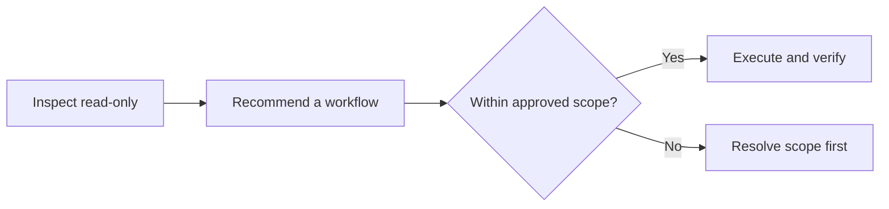

# AIC — AI Culture

Created and maintained by **[Boom-Vitt](https://github.com/Boom-Vitt)**.

**Choose the workflow before the agent starts changing things.**

AIC helps your AI agent turn a task or project plan into the right workflow: inspect relevant context read-only, identify dependencies and risks, select a reusable workflow pattern, and define ownership and acceptance before execution.

Your existing host supplies the reasoning. AIC provides portable instructions and deterministic local helpers—not a bundled model, an automatic intent classifier, or a reason to add more agents to every task.

AIC is a normal **public GitHub repository**, not a GitHub template repository. Its workflow families are approaches to doing work, not repository scaffolds.

## Install

Requirements: Git for obtaining the repository; Python **3.11+** for helpers; a compatible host agent. Managed installation/uninstallation requires POSIX directory-descriptor support (macOS/Linux); Windows mutations fail closed instead of using an unsafe fallback. No pip packages or model keys are required by AIC.

Clone the repository, then install into your host's **documented skill directory**:

```sh
git clone https://github.com/Boom-Vitt/aic.git
cd aic
python3 scripts/aic.py install --agent generic --destination /absolute/path/to/skills
```

The destination is the directory that contains skills, not the AIC directory itself. Review a pinned revision before executing local code when reproducibility matters; do not pipe a remote installer into a shell.

Named adapters, project/user scopes and host-specific discovery details are documented in the [compatibility guide](docs/compatibility.md). A successful file installation is not proof of native discovery.

No settings are edited and no agent is launched by installation. Intact identical installs are unchanged; unmanaged or user-modified content is refused rather than overwritten.

Updates are explicit: fetch and review the desired revision, then rerun the same managed installation command. Repository research updates do not silently synchronize installed copies or overwrite local edits.

## Use

Restart/reload skill discovery as your host requires, then ask:

> Use AIC to inspect this project read-only and recommend how to approach this task or project plan. Select a workflow family from the evidence, explain the topology, scope, ownership, risks and acceptance checks, and obtain any required approval before changing files or launching agents.



## What gets selected?

Task category, workflow family (`template` in JSON), current-stage topology and runtime/model are separate decisions. The host AI uses actual acceptance, dependencies, unknowns, risks and available capabilities—not hardcoded request keywords or a universal solo/team default.

| Workflow family | Select when | Topology |
| --- | --- | --- |
| `direct` | One owner can carry coherent, coupled work through acceptance | `solo` |
| `explore-build` | Two or more substantial independent unknowns need evidence before synthesis and any approved build | `parallel` exploration |
| `coordinated-delivery` | Downstream work needs accepted upstream artifacts, or ready implementation branches have independent contracts and one integration owner | `sequential` or `parallel` |
| `independent-review` | Consequential acceptance risk justifies a separately briefed evaluator of the actual artifact | `generator-evaluator` |
| `adaptive-controller` | Long work needs durable state/next-action selection, or explicitly approved optimization needs measured adaptation | Any supported current-stage topology |

Read the [selection guide](skills/aic/references/workflows.md), [complete family contracts](skills/aic/references/templates.md), and [project-plan guide](skills/aic/references/project-plans.md). Compose stages as needed and reselect when evidence or dependencies change, preserving original project acceptance and authority. Ordinary continuity does not require a benchmark; measured optimization requires a correct baseline/oracle, comparable workloads and bounded resources. No project must use all five families.

## Evidence and rights

The [evidence ledger](skills/aic/references/research.md) records exact source versions, evidence quality, applicability limits, license status and checked dates. Summaries and workflow patterns are original AIC material; cited publications are reference-only. No paper PDFs, figures, prompts or research implementations are bundled. Detailed source attribution and required notices remain in the reference files and [NOTICE](NOTICE).

## Local helpers

```sh
python3 scripts/aic.py agents
python3 scripts/aic.py inspect /path/to/project
python3 scripts/aic.py check-plan recommendation.json --project /path/to/project
python3 scripts/aic.py memory-read --project /path/to/project
```

`inspect` returns a bounded metadata inventory, not a source-code dump. `check-plan` validates recommendation structure and scope, not semantic truth or consent. Learn more about [routing](skills/aic/references/routing.md), [scoped memory](skills/aic/references/memory.md), and [approved handoffs](skills/aic/references/handoffs.md).

Recommendation schema 3 requires an explicit `template` and checks its topology compatibility. Schema-1/2 recommendations and retired template IDs are rejected, without aliases or silent migration. Reassess older recommendations from the real task, current dependencies and authorization; see the [full contract](skills/aic/references/routing.md). Installer, memory, maintenance and outer handoff formats retain their separately documented versions. Validation cannot prove semantic selection, interface independence or human consent.

Inspection has finite entry and directory budgets, including excluded entries. Returned selected items are sorted, but a truncated subset follows filesystem enumeration order rather than claiming a globally sorted scan of an arbitrarily wide directory.

The rule is **recommend first, approve once, then execute within scope**. Existing explicit task approval is sufficient; do not ask again for every routine step. New spending, credentials, deployment or materially expanded scope still require their own authorization. A skill and a digest flag are not a security sandbox or proof of human identity.

## Optional supervision

For approved local terminal supervision, see the [tmux 3.8 guide](skills/aic/references/supervision.md) and original [task-local profile](skills/aic/assets/tmux.conf). Use an explicit task-owned socket, trusted per-run config and scoped sessions/panes; never repurpose an existing server or modify global settings. Native OMP children are normally clearer in Agent Hub (`Alt+A`, tree `t`) when available, not one pane per child.

Track owner, dependencies, blockers, evidence and next action in existing task artifacts. A running process, dead pane or zero exit status does not establish acceptance; unknown usage/cost remains unknown. Detach/reattach is not host-shutdown recovery or authorization for unattended model work. This is an optional supervision procedure, not a new AIC launcher, monitoring service or cross-CLI adapter.

## Research maintenance

The optional [repository maintainer](docs/maintenance.md) checks primary sources daily, creates assigned research/adoption tasks, and proposes original evidence records for independent review. Automatic merges are limited to new research records after local and repository checks pass.

Workflow instructions, code, CI, credentials and permission changes remain manual. The maintainer is separate from the installed skill, uses at most two unattended agent runs per day, and requires explicit setup; installing AIC does not enable it.

## Uninstall

Use the same destination selectors as installation:

```sh
python3 scripts/aic.py uninstall --agent generic --destination /absolute/path/to/skills
```

Only an intact manifest-owned AIC directory is removed. Modified files, extra content and unrelated parent/sibling data are preserved. Keep your edits and inspect a refusal; there is no force-delete option.

## Verify

```sh
./scripts/verify.sh
```

Verification is offline and uses isolated fixtures. It exercises installation boundaries, recommendation schemas, path/privacy protections, memory authority, maintenance safety gates and launch dry runs. Actual host consumption and operational maintenance have separate evidence; see [verification results and limits](docs/verification.md). The offline command does not launch models, publish changes or provision resources.

## Project layout

- `skills/aic/`: self-contained skill, references, catalog, adapter registry and Python helpers.
- `scripts/`: checkout CLI and offline verification entrypoint.
- `maintenance/`: opt-in primary-source discovery, bounded agent jobs and guarded repository maintenance.
- `tests/`: consumer-visible regressions and scenario fixtures.
- `docs/`: compatibility, evidence, provenance and verification.

[Contributing](CONTRIBUTING.md) · [Security](SECURITY.md) · [License](LICENSE) · [Notice](NOTICE)
