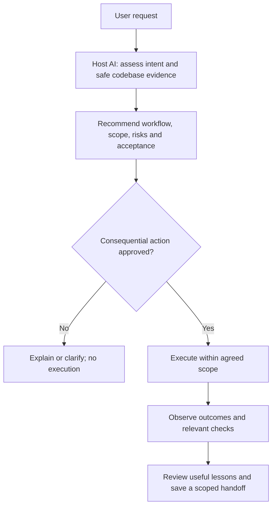

# AIC — AI Culture

**Choose the workflow before the agent starts changing things.**

AIC is a portable [Agent Skill](https://agentskills.io/) that helps your existing AI agent classify a request, inspect relevant codebase context read-only, and recommend a suitable workflow. It includes local helpers for safe installation, recommendation validation, scoped reference memory and optional approved Orca-to-omp handoff.

AIC does not call another inference API, install a model, require Orca, or claim that more agents always produce better results. The host agent supplies the reasoning; Python supplies deterministic checks and local operations.

## Install

Requirements: Git for obtaining the repository; Python **3.11+** for helpers; a compatible host agent. Managed installation/uninstallation requires POSIX directory-descriptor support (macOS/Linux); Windows mutations fail closed instead of using an unsafe fallback. No pip packages or model keys are required by AIC.

One shell command to obtain AIC and install its self-contained skill for Claude Code:

```sh
git clone https://github.com/Boom-Vitt/aic.git && python3 aic/scripts/aic.py install --agent claude-code --scope user
```

Review a pinned revision before executing local code if you require reproducible installation. AIC does not recommend piping a remote script into a shell. Once you have the checkout, installation itself is one command:

```sh
python3 scripts/aic.py install --agent codex --scope project --project /path/to/project
```

Replace the agent with `claude-code`, `codex`, `omp`, `pi`, `hermes`, `openclaw`, `cursor`, `gemini-cli`, `opencode`, or `copilot-cli`. See [compatibility and profile caveats](docs/compatibility.md). Installing files is not proof that a particular installed host version has discovered or used them.

For a compatible host not listed, use its documented skill root explicitly:

```sh
python3 scripts/aic.py install --agent generic --destination /path/to/documented/skills-root
```

No settings are edited and no agent is launched by installation. Intact identical installs are unchanged; unmanaged or user-modified content is refused rather than overwritten.

## Use

Restart/reload skill discovery as your host requires, then ask:

> Use AIC to inspect this project read-only and recommend how to approach this task. Explain the workflow, topology, scope, risks and verification before changing files or launching agents.

Typical explicit invocation: Claude Code `/aic`, Codex `$aic`, omp/Pi `/skill:aic`. Other hosts use their own skill selection; AIC does not invent universal slash commands.



## What gets selected?

| Work | Candidate approach |
| --- | --- |
| Small fix, shared invariant, dependent reasoning | One capable agent |
| Substantial independently checkable questions | Bounded parallel branches and one integrator |
| Consequential change or repeated quality misses | Generator plus independent evaluator |
| Observed failure | Reproduce, establish cause, fix and recheck |
| Unresolved tradeoffs | Evidence-backed design recommendation before execution |

The [workflow guide](skills/aic/references/workflows.md) explains the evidence and its limits. No universal ranking of Claude, GPT, DeepSeek, omp, Codex or other hosts is asserted.

## Local helpers

```sh
python3 scripts/aic.py agents
python3 scripts/aic.py inspect /path/to/project
python3 scripts/aic.py check-plan recommendation.json --project /path/to/project
python3 scripts/aic.py memory-read --project /path/to/project
python3 scripts/aic.py orca-plan recommendation.json --project /absolute/path/to/new-project --name task
```

`inspect` produces a bounded metadata inventory, not a source-code dump. `check-plan` validates the AI's recommendation, not its semantic truth. `orca-plan` is a non-mutating preview; an actual handoff needs a separately approved exact digest and a supported local Orca CLI. See [routing](skills/aic/references/routing.md), [memory](skills/aic/references/memory.md) and [handoffs](skills/aic/references/handoffs.md).

Inspection has finite entry and directory budgets, including excluded entries. Returned selected items are sorted, but a truncated subset follows filesystem enumeration order rather than claiming a globally sorted scan of an arbitrarily wide directory.

The rule is **recommend first, approve once, then execute within scope**. Existing explicit task approval is sufficient; do not ask again for every routine step. New spending, credentials, deployment or materially expanded scope still require their own authorization. A skill and a digest flag are not a security sandbox or proof of human identity.

## Uninstall

Use the same destination selectors as installation:

```sh
python3 scripts/aic.py uninstall --agent codex --scope project --project /path/to/project
```

Only an intact manifest-owned AIC directory is removed. Modified files, extra content and unrelated parent/sibling data are preserved. Keep your edits and inspect a refusal; there is no force-delete option.

## Verify

```sh
./scripts/verify.sh
```

Verification is offline and uses isolated fixtures. It checks install/uninstall boundaries, recommendation schemas and routing scenarios, privacy, memory authority and launch dry-run immutability. Actual host-AI consumption is a separate smoke observation; see [verification evidence and limits](docs/verification.md). No verification command provisions cloud resources or starts a paid model service.

## Project layout

- `skills/aic/`: self-contained skill, references, catalog, adapter registry and Python helpers.
- `scripts/`: checkout CLI and offline verification entrypoint.
- `tests/`: consumer-visible regressions and scenario fixtures.
- `docs/`: compatibility, evidence, provenance and verification.

[Contributing](CONTRIBUTING.md) · [Security](SECURITY.md) · [License](LICENSE) · [Attribution](NOTICE)

AIC follows Anthropic's established skills layout and Apache-2.0 authoring guidance, with [pinned provenance](skills/aic/references/provenance.md). AIC-specific content is newly authored. No private skill collection or proprietary project files are distributed.
