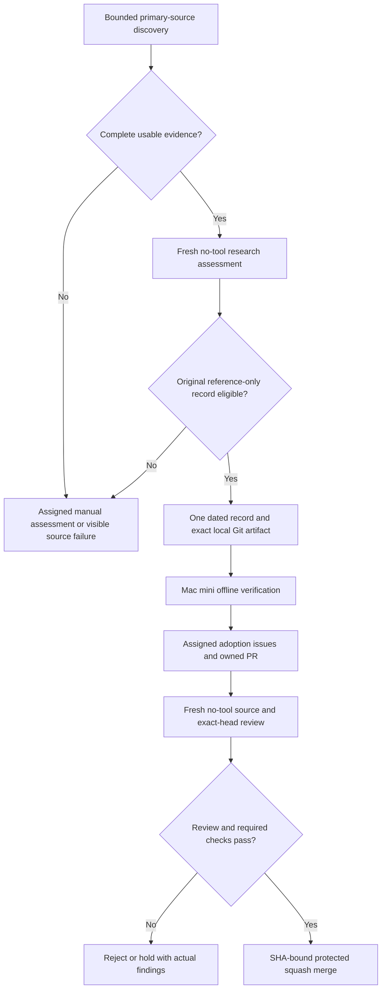

# Research maintenance

AIC's optional repository maintainer checks primary research and proposes original factual evidence records. It is separate from the portable skill: installing AIC does not start a scheduler, configure billing or give an agent repository permissions.

The maintainer is bound to `Boom-Vitt/aic` and its owner. It is not a general public-PR bot or a claim that one model is universally best. The [verification receipt](verification.md) distinguishes implemented contracts, actual model/GitHub checks and observed service state.

## Approved authority

| Boundary | Policy |
| --- | --- |
| Automatic changes | One **new** regular, non-executable UTF-8 file: `skills/aic/references/research-updates/YYYY-MM-DD.md` |
| Automatic merges | Only the controller's own exact non-fork PR/head, after source, review, local and protected-repository gates |
| Manual changes | Workflow instructions/templates, code, CI, credentials, permissions and security policy |
| Agent usage | Two reserved unattended runs per UTC day total; at most one researcher and one reviewer |
| Authentication | Existing subscription-backed CLI login; no new provider, key or API-billing configuration |
| Agent capabilities | No tools, extensions, skill/rule/context discovery, persisted conversation or model fallback |
| Runtime | Explicitly activated Mac mini LaunchAgent, polling every 15 minutes; daily discovery while online |

An agent's role, a label, an issue, a schema-valid result or a positive self-grade is not authorization. The controller keeps GitHub authority; the research and review processes receive public source packets, not GitHub credentials or arbitrary repository instructions. The provider's existing plan and usage limits still apply. The CLI's estimated cost stop is not a hard invoice ceiling; an in-flight request can finish beyond an estimate.

Each role gets a private `HOME` and its own empty `.omp` project anchor, so ambient home/project plugin registries are not its startup context. A read-only `omp config path --json` probe resolves the existing default CLI agent directory; only the child's `PI_CODING_AGENT_DIR` points there for existing authentication. The adapter does not copy credentials, edit global settings/plugins or create a different login. The original tool/discovery/fallback restrictions remain in force.

The runtime binding is hashed in `runtime.json` alongside the packet, CLI isolation overlay and capture logs, under receipt format `aic-no-tool-agent-v2`. Older receipts stay preserved as historical evidence but are not silently reused under the new isolation contract.

These path semantics were checked against [OMP v18.16.0's environment documentation](https://github.com/can1357/oh-my-pi/blob/650f3a108229ee11bf68ba3377f4e8c3391cd424/docs/environment-variables.md) and [startup/discovery implementation](https://github.com/can1357/oh-my-pi/blob/650f3a108229ee11bf68ba3377f4e8c3391cd424/packages/coding-agent/src/discovery/helpers.ts). In particular, `--plugin-dir` **merges** ambient roots; it is not an isolation switch. The referenced runtime is [MIT-licensed](https://github.com/can1357/oh-my-pi/blob/650f3a108229ee11bf68ba3377f4e8c3391cd424/LICENSE), credited there to Mario Zechner, Can Bölük and Stencil Labs. AIC uses its public CLI/path contract; no runtime source is vendored.


## Source and quality policy

- Discover from documented primary publication/metadata services and official research/engineering pages. An index hit is a candidate, not verified science.
- Preserve author credit, actual publication/revision dates, source URLs, evidence hashes, retrieval time and evidence tier. Preprints and first-party engineering reports are not peer-reviewed controlled trials.
- Require complete primary-method evidence for automatic factual records. Abstract-only, truncated, inaccessible or materially ambiguous evidence remains visible and requires manual work.
- Compare methods, findings, limits and task applicability. Distinguish equal call ceilings from equal cost/tokens, candidate coverage from a correctly selected result, and source-declared results from independent reproduction.
- Treat publication content rights separately from implementation-code licenses. Unknown/restrictive rights remain explicitly **reference-only**, never permission to copy. Publish newly authored facts and citations, not upstream prose, tables, figures, prompts, datasets or code.
- A conservative long-phrase overlap gate escalates possible copying; it is not legal clearance. A fresh reviewer checks grounding, rights, original expression and scope against the original sources, without the generator's persuasive self-assessment.
- New methods can create assigned manual adoption tasks. They do not automatically become workflow instructions. Adoption needs a real task, original acceptance and relevant checks.
- A daily check may find no eligible record. Never manufacture a daily update or infer a universal vendor ranking.

The [research ledger](../skills/aic/references/research.md) records the baseline sources, rights evidence and applicability limits. Dated additions live in the [research-record index](../skills/aic/references/research-updates/README.md).

Discovery obeys [arXiv's API terms](https://info.arxiv.org/help/api/tou.html): one connection and at least three seconds between legacy API requests. Descriptive metadata's CC0 status does not license paper content. Other primary interfaces include [Crossref's REST documentation](https://www.crossref.org/documentation/retrieve-metadata/rest-api/). Source outages and partial coverage are reported rather than silently replaced with an empty success.

## Execution and merge gates



`main` must require pull requests, up-to-date checks and administrator enforcement, with no force push/deletion or bypass allowances. Required contexts:

- `offline-contracts`: the actual GitHub-hosted verification job, from the genuine Actions app and the exact head.
- `aic/macmini`: actual local verification of the permitted artifact.
- `aic/independent-review`: exact-head/source-bound independent assessment.

Review evidence is posted as an assessment comment and owner-authored status, **not** a fabricated approval from a different GitHub identity. Fresh context reduces generator influence; it does not prove independent model errors or reproduce the cited experiments. Additional protected rules remain authoritative. Unknown rulesets or a nonmatching policy block setup rather than being weakened.

The local verifier starts from the approved repository's trusted main and adds only the validated research record. It does not execute arbitrary public PR code. Do not register this Mac as a public self-hosted Actions runner; see [GitHub's runner security warning](https://docs.github.com/en/actions/how-tos/manage-runners/self-hosted-runners/add-runners) and [secure-use reference](https://docs.github.com/en/actions/reference/security/secure-use).

## Preview and inspect

Python 3.11+, the existing authenticated CLI, `gh`, and Git are required for approved execution. Preview needs no model or GitHub write:

```sh
python3 scripts/maintain.py plan
python3 scripts/maintain.py run-once
python3 scripts/maintain.py discover
python3 scripts/maintain.py status
```

`discover` reads primary sources but starts no model and publishes nothing. Its output identifies partial evidence and errors. `run-once` without `--publish` is a non-mutating policy preview.

For a deliberately selected historical source, `discover --bootstrap URL` keeps the actual old publication date. An operational backfill smoke must be labeled historical, never reported as today's new paper.

## Owner-approved setup

Run local verification and inspect the relevant security/quality review before publishing or activating:

First publish the locally verified initial maintainer through a **manual owner-reviewed PR**, with the repository's existing CI passing. Do this before installing maintainer-only required contexts: the record-only bot cannot approve or publish its own code, and its custom statuses do not exist in the initial release. Configuration checks that the essential maintainer files are already published in `main`; that prerequisite is not a substitute for review or actual runtime checks.

```sh
./scripts/verify.sh
```

After the initial verified maintainer is published:

```sh
python3 scripts/maintain.py configure
python3 scripts/maintain.py configure --approve
python3 scripts/maintain.py run-once --publish
```

`configure --approve` is a consequential repository operation: it creates the required classic protection only when unprotected and creates owned task labels. It refuses to overwrite an existing nonmatching policy. It must only be used within actual owner approval, not because an issue or source requested it.

Use an exact, verified commit published in the approved main for the service. Replace `PUBLISHED_COMMIT_SHA` with that observed 40-character commit; the installer checks publication and exact Git blob identities rather than trusting the name:

```sh
python3 scripts/maintain.py install-service --published-sha PUBLISHED_COMMIT_SHA
python3 scripts/maintain.py install-service --published-sha PUBLISHED_COMMIT_SHA --approve
python3 scripts/maintain.py service-status
```

The first command previews. Explicit activation installs **only** `ai.aic.research-maintainer`. Its immutable source snapshot, manifest, private evidence, logs and durable state live beneath the checkout's ignored `.work/maintainer/`. The plist contains a minimal PATH, no tokens. Source is taken from the published Git commit, not a possibly modified working tree. Repeated intact installation is unchanged; modified/unmanaged artifacts are preserved. There is no automatic self-update or restart of another service.

This scheduler updates repository research records, not other people's installed skills. Refresh a managed skill installation explicitly from a reviewed revision; modified/unmanaged installations remain protected. The immutable scheduler itself also requires an explicit reviewed upgrade; it does not self-modify from new papers.

The scheduled process uses isolated Python imports and runs one cycle, then exits. `StartInterval=900` and `RunAtLoad` provide polling; there is no busy `KeepAlive` loop. The Mac must be awake, online and logged into the user session. This is not an uninterrupted-uptime guarantee. After activation inspect actual status/logs and a real cycle; a generated plist alone is not proof.

## Durability, uncertainty and stopping

- Reserve usage before launching a role; reserved, failed and interrupted runs count. Do not delete/reset the database or rename jobs to bypass the daily allowance.
- Persist source hashes, exact artifacts, accepted results, effect identities and PR head. Only one integration job owns the mutation surface.
- Accepted role reuse rechecks its original receipt SHA-256, durably anchored in SQLite, and every bound packet/trace/config/log. A newly edited receipt cannot authorize newly edited evidence; missing anchors hold rather than being inferred or regenerated.
- An uncertain issue, push, PR, comment or merge is not blindly replayed. Read-only reconciliation must confirm its effect; otherwise hold the job for owner inspection.
- A changed head, source packet, private receipt or unexpected checkout change invalidates reuse. Do not overwrite user changes, force-push a repair, label a planned check passed or relax acceptance to get a merge.
- Rejected records do not become active instructions. Missing source evidence, provider access, permissions or required checks remain explicit blockers.
- A merge is SHA-conditional. Owned remote branch cleanup uses a conditional Git lease to preserve concurrent changes; closing a PR itself has no server-side head CAS and is non-destructive to its branch contents.

Main integration journals the prior head/base, exact target main and deterministic expected commit/tree before changing the checkout. Recovery accepts only that intended integration, verifies the one-record diff against the new base, and invalidates the old review. This requires Git's `merge-tree --write-tree` support. Rejection journals a cleanup phase before closing/deleting; a restart resumes cleanup rather than recreating or integrating a rejected branch. Abstract-only members of mixed batches receive their own manual-evidence disposition.

Owned clone cleanup preserves stashes, tags, unexpected refs or ref targets, ignored/untracked owner files and extra worktrees. Do not remove these guards to clear a held job; inspect and preserve the actual work.

Read status with `python3 scripts/maintain.py status`; read scheduler ownership/state with `service-status`. Inspect private logs rather than publishing raw source packets, credentials or traces.

To stop/remove the owned scheduler, preview first, then explicitly approve:

```sh
python3 scripts/maintain.py uninstall-service
python3 scripts/maintain.py uninstall-service --approve
```

Removal verifies the owned intact plist, immutable release and loaded-label identity before stopping anything. Durable state and logs remain; removing a service does not reset usage or authorize replay. Existing unrelated services/settings are outside this tool's scope.

Agent capture runs on the controller's main thread so scoped SIGTERM/SIGINT handlers can kill and reap only its isolated child process group, then restore prior handlers. Interrupted runs still consume their reservation and retain evidence.

Removal records private, configuration-bound `shutdown.json` evidence before bootout and waits up to 30 seconds for the recorded controller PID to disappear. An uncertain exit preserves files and reports `removal-pending` through status; explicit removal can resume after shutdown is confirmed. A replacement controller, changed evidence or unproven ownership blocks removal. No cached PID is signaled directly, and pending removal cannot silently reactivate the scheduler.
